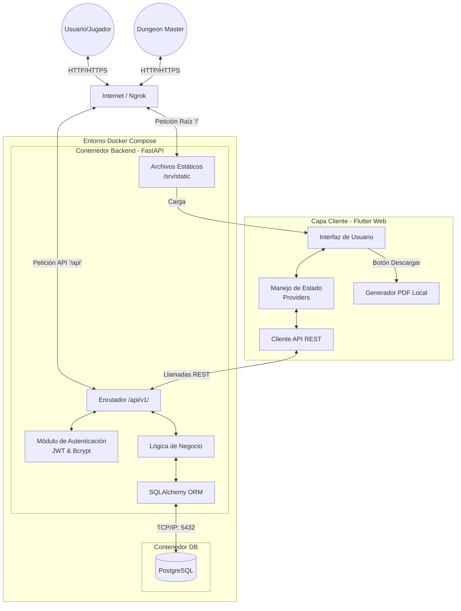

# Diagrama de Arquitectura de la Plataforma DnD

A continuación se ilustra la arquitectura de alto nivel del sistema, mostrando cómo el usuario interactúa con la plataforma y cómo se comunican los componentes internos.

## Explicación del Flujo
1. **Acceso Inicial**: El usuario entra a la URL expuesta por Ngrok. El servidor FastAPI intercepta las peticiones a la raíz (`/`) y devuelve los archivos compilados de Flutter alojados en el volumen de `StaticFiles`.
2. **Uso de la App**: Una vez cargada, la aplicación de Flutter maneja toda la UI mediante sus `Providers`. 
3. **Peticiones a la API**: Cuando se necesita guardar o leer un personaje, el `ApiClient` realiza peticiones a `/api/v1/...`. FastAPI procesa estas peticiones pasando por el módulo de autenticación (Auth) y llegando a la lógica de negocio.
4. **Base de Datos**: FastAPI utiliza SQLAlchemy de forma asíncrona para interactuar con la base de datos PostgreSQL, la cual se ejecuta en un contenedor completamente separado y seguro.
5. **Generación de PDF**: Esto ocurre 100% del lado del cliente (Frontend). El navegador del usuario genera el documento y descarga el binario directamente, sin recargar el servidor.
