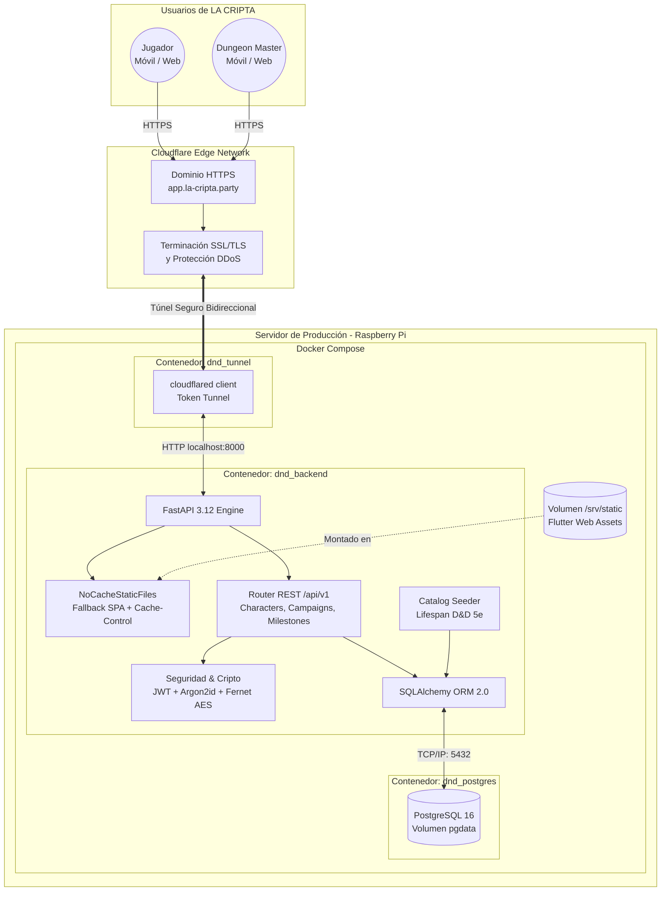

# Diagrama de Arquitectura — LA CRIPTA

A continuación se ilustra la arquitectura de alto nivel de **LA CRIPTA**, mostrando el flujo de interacción de los usuarios a través del túnel seguro de Cloudflare, la capa de contenedores Docker y la comunicación interna entre servicios.

---

## Explicación Detallada de los Flujos

1. **Acceso Seguro sin Puertos Abiertos:**
   - Tanto los jugadores como el Dungeon Master ingresan a través del dominio seguro `https://app.la-cripta.party/`.
   - La red perimetral de Cloudflare gestiona los certificados SSL/TLS y redirige las peticiones al contenedor `dnd_tunnel` (`cloudflared`) que mantiene una conexión saliente segura desde la Raspberry Pi, evitando tener que abrir puertos en el router o configurar DNS dinámico.

2. **Carga de la Aplicación Web (SPA):**
   - El contenedor `dnd_backend` recibe el tráfico en el puerto interno `8000`.
   - Si la petición es hacia la raíz (`/`) o hacia una ruta profunda de navegación de Flutter (`/login`, `/my-characters`, `/campaign/123`), el componente `NoCacheStaticFiles` entrega `index.html` con cabeceras anti-caché estrictas.
   - Flutter Web se inicializa utilizando **CanvasKit Local**, descargando los recursos compilados desde el volumen `/srv/static`.
   - Gracias al script `scripts/post_build_web.py`, los archivos `flutter_bootstrap.js` y `main.dart.js` cuentan con sellos de versión únicos, logrando que Cloudflare eluda la caché perimetral (`cf-cache-status: BYPASS`) y garantice código fresco.

3. **Operaciones REST y Lógica de Juego:**
   - La interfaz de Flutter invoca los endpoints de la API (`/api/v1/...`) mediante `ApiClient`.
   - Las rutas protegidas verifican el token JWT y su `token_version` en la base de datos.
   - Las operaciones de creación, subida de nivel, hitos de campaña y persistencia de experiencia (XP) se validan mediante esquemas Pydantic y se ejecutan atómicamente a través de SQLAlchemy ORM contra la base de datos PostgreSQL.
