# Diagrama de Base de Datos (Entidad-Relación) — LA CRIPTA

A continuación se detalla la estructura relacional completa de la base de datos alojada en PostgreSQL (y compatible con SQLite para testing), incluyendo tanto las entidades de usuario, campaña y sesión como los catálogos oficiales de D&D 5e (migrados desde archivos JSON estáticos hacia la base de datos) y el sistema de progresión por hitos y experiencia (XP).

```mermaid
erDiagram
    USERS {
        uuid id PK
        string username
        string username_norm "Unique, Index"
        text email_encrypted "Fernet AES-128"
        string email_hash "HMAC Blind Index, Unique"
        string password_hash "Argon2id"
        int token_version
        datetime created_at
    }

    CAMPAIGNS {
        uuid id PK
        string name
        text description
        text dm_notes "Notas ocultas del DM"
        text board "Tablon de anuncios de la mesa"
        string join_code "Unique, Index"
        uuid dm_id FK "References users.id"
        datetime created_at
    }

    CAMPAIGN_MEMBERS {
        uuid campaign_id PK,FK "References campaigns.id"
        uuid user_id PK,FK "References users.id"
        string role "'dm' | 'player'"
        datetime joined_at
    }

    CAMPAIGN_MILESTONES {
        uuid id PK
        uuid campaign_id FK "References campaigns.id (ondelete CASCADE)"
        string title "Titulo del objetivo narrativo"
        text description "Detalles del hito"
        int target_level "Nivel objetivo de los personajes"
        int xp_granted "Experiencia otorgada"
        boolean is_completed "Estado de cumplimiento"
        datetime completed_at "Fecha de resolucion"
        datetime created_at
    }

    CHARACTERS {
        uuid id PK
        uuid owner_id FK "References users.id"
        uuid campaign_id FK "References campaigns.id (Nullable)"
        string name
        string race "Referencia slug de dnd_races"
        string subrace "Referencia slug de dnd_subraces (Nullable)"
        string class_slug "Referencia slug de dnd_classes"
        int level "Nivel actual (1-20)"
        int experience "Puntos de XP acumulados (default 0)"
        string avatar_url
        string status "'alive' | 'dead' | 'undead' | 'lost'..."
        string status_note
        jsonb sheet "Atributos, salvaciones, competencias, equipo..."
        int version "Control de concurrencia optimista"
        datetime created_at
        datetime updated_at
    }

    STATUS_EVENTS {
        uuid id PK
        uuid campaign_id FK "References campaigns.id"
        uuid character_id FK "References characters.id"
        uuid changed_by FK "References users.id"
        string old_status
        string new_status
        string note
        datetime created_at
    }

    %% Tablas de Catalogo D&D 5e (Migradas de JSON a Base de Datos)
    DND_RACES {
        string slug PK "Identificador único (p.ej. 'elf', 'human')"
        string name "Nombre en espanol (p.ej. 'Elfo')"
        string size "Tamanio ('Mediano', 'Pequeno')"
        int speed "Velocidad base en pies"
        jsonb ability_bonuses "Bonificadores raciales fijos"
        jsonb languages "Idiomas raciales"
        int extra_languages "Idiomas a eleccion"
        jsonb skills "Competencias fijas"
        int skill_choices "Numero de competencias elegibles"
        int bonus_choices "Numero de bonificadores elegibles"
        jsonb proficiencies "Competencias con armas/armaduras"
        jsonb traits "Rasgos raciales (nombre, descripcion)"
        text description "Descripcion narrativa"
    }

    DND_SUBRACES {
        string slug PK "Identificador único (p.ej. 'high_elf')"
        string race_slug FK "References dnd_races.slug"
        string name "Nombre de subraza"
        jsonb ability_bonuses "Bonificadores de subraza"
        int speed "Velocidad alternativa (Nullable)"
        int hp_per_level "PG adicionales por nivel"
        jsonb proficiencies "Competencias de subraza"
        jsonb traits "Rasgos de subraza"
    }

    DND_CLASSES {
        string slug PK "Identificador único (p.ej. 'fighter', 'wizard')"
        string name "Nombre en espanol"
        int hit_die "Dado de golpe (d6, d8, d10, d12)"
        string primary_ability "Atributo principal"
        jsonb saving_throws "Tiradas de salvacion competentes"
        jsonb skill_pool "Lista de habilidades elegibles"
        int skill_choices "Numero de habilidades a escoger"
        jsonb armor_proficiencies "Armaduras competentes"
        jsonb weapon_proficiencies "Armas competentes"
        jsonb starting_ac "Formula de CA inicial / defensas naturales"
        jsonb subclasses "Subclases disponibles y nivel de eleccion"
        jsonb features "Rasgos de clase ordenados por nivel"
        jsonb spellcasting "Configuracion de conjuros (si aplica)"
    }

    DND_CLASS_LEVELS {
        int id PK "Autoincremental"
        string class_slug FK "References dnd_classes.slug"
        int level "Nivel de clase (1 al 20)"
        int proficiency_bonus "Bonificador de competencia (+2 a +6)"
        jsonb features "Rasgos desbloqueados en este nivel"
        jsonb spell_slots "Espacios de conjuro por nivel de conjuro"
    }

    DND_BACKGROUNDS {
        string slug PK "Identificador único (p.ej. 'acolyte')"
        string name "Nombre de trasfondo"
        jsonb skills "Competencias en habilidades que confiere"
        jsonb tools "Competencias en herramientas"
        int extra_languages "Numero de idiomas a eleccion"
        jsonb equipment "Equipo inicial entregado"
        jsonb feature "Rasgo narrativo especial"
    }

    DND_SKILLS {
        string slug PK "Clave canónica en ingles (p.ej. 'stealth')"
        string key "Clave de hoja en espanol ('sigilo')"
        string name "Nombre formal ('Sigilo')"
        string ability "Atributo asociado ('dex')"
    }

    DND_ABILITY_SCORE_INFO {
        string slug PK "Codigo de 3 letras (p.ej. 'str', 'dex')"
        string name "Nombre completo ('Fuerza')"
        text description "Explicacion narrativa y mecanica"
        jsonb sample_actions "Acciones tipicas que requieren chequeo"
    }

    DND_RULE_CONFIGS {
        string key PK "Clave de regla (p.ej. 'point_costs')"
        jsonb data "Matriz o diccionario de reglas mecanicas"
    }

    %% Relaciones del Sistema
    USERS ||--o{ CAMPAIGNS : "Crea (como DM)"
    USERS ||--o{ CAMPAIGN_MEMBERS : "Participa en"
    CAMPAIGNS ||--o{ CAMPAIGN_MEMBERS : "Tiene miembros"
    CAMPAIGNS ||--o{ CAMPAIGN_MILESTONES : "Define hitos de progresion"
    USERS ||--o{ CHARACTERS : "Es dueno de"
    CAMPAIGNS ||--o{ CHARACTERS : "Agrupa personajes activos"
    CHARACTERS ||--o{ STATUS_EVENTS : "Registra historial de"
    CAMPAIGNS ||--o{ STATUS_EVENTS : "Alberga eventos de"
    USERS ||--o{ STATUS_EVENTS : "Ejecuta cambio de estado"

    %% Relaciones de Catalogos con Datos y Personajes
    DND_RACES ||--o{ DND_SUBRACES : "Tiene variantes / subrazas"
    DND_RACES ||--o{ CHARACTERS : "Define raza base de"
    DND_CLASSES ||--o{ CHARACTERS : "Define clase de"
```

---

## Explicación de las Entidades

### 1. Entidades de Gestión de Partida y Usuarios

1. **`USERS` (Usuarios):**
   - Maneja la identidad con máxima seguridad criptográfica: contraseñas con **Argon2id**, correos cifrados bidireccionalmente con **Fernet (AES-128)** y búsquedas mediante índice ciego **HMAC (blind index)**.
   - Cuenta con control de revocación de sesiones mediante `token_version`.

2. **`CAMPAIGNS` (Campañas):**
   - Representa la mesa de juego dirigida por un Dungeon Master (`dm_id`).
   - Dispone de un código único de 8 caracteres (`join_code`) para incorporación de jugadores, además de notas privadas exclusivas para el DM (`dm_notes`) y un tablón público (`board`).

3. **`CAMPAIGN_MEMBERS` (Miembros de Campaña):**
   - Tabla asociativa que gestiona los participantes de cada mesa y su rol (`dm` o `player`).

4. **`CAMPAIGN_MILESTONES` (Hitos de Campaña):**
   - Modela los objetivos narrativos de la campaña definidos por el DM (`title`, `description`, `target_level`).
   - Calcula y almacena la experiencia requerida (`xp_granted`) para que los personajes alcancen el nivel objetivo.
   - Al marcar `is_completed = true`, otorga automáticamente la experiencia a todos los personajes vinculados a la campaña.

5. **`CHARACTERS` (Personajes):**
   - Cada personaje pertenece a un usuario (`owner_id`) y puede estar asignado a lo sumo a una campaña activa (`campaign_id`).
   - Almacena la experiencia acumulada (`experience`) de forma persistente para permitir que la progresión se conserve si el personaje cambia de campaña.
   - La ficha técnica detallada (puntuaciones, bonificadores, inventario modular, conjuros) reside en la columna `sheet` como `JSONB`, protegida por `version` para evitar colisiones en escrituras concurrentes (*optimistic locking*).
   - Registra el estado narrativo (`alive`, `dead`, `undead`, etc.) gestionado por el DM con una nota explicativa opcional (`status_note`).

6. **`STATUS_EVENTS` (Eventos de Estado):**
   - Registro de auditoría y crónica que guarda cada modificación de estado que el DM aplica a un personaje de la campaña, registrando quién lo hizo, el estado previo y la fecha.

---

### 2. Entidades de Catálogo Oficial D&D 5e (Migradas de JSON a Base de Datos)

Anteriormente, los catálogos y reglas de creación estaban codificados como archivos JSON estáticos en el repositorio. Ahora están estructurados como modelos ORM relacionales gestionados en la base de datos:

1. **`DND_RACES` (Razas):**
   - Almacena las razas oficiales (Humano, Enano, Elfo, etc.) con sus características físicas (tamaño, velocidad), idiomas, competencias inherentes y bonificadores de característica.
   - Soporta razas con opciones dinámicas como los Semielfos (`bonus_choices` y `skill_choices`).

2. **`DND_SUBRACES` (Subrazas):**
   - Variantes vinculadas mediante clave foránea a `dnd_races.slug` (p. ej. *Enano de las colinas*, *Elfo de los bosques*).
   - Otorga bonificaciones adicionales de atributos, vida por nivel (`hp_per_level`), velocidad alternativa y rasgos especiales.

3. **`DND_CLASSES` (Clases):**
   - Registro de las 12 clases oficiales (Bárbaro, Bardo, Clérigo, Guerrero, Pícaro, Mago, etc.).
   - Define el dado de golpe (`hit_die`), tiradas de salvación competentes, reglas de selección de habilidades (`skill_choices`), fórmulas de armadura natural (`starting_ac`) y progresión de rasgos por nivel (`features`).

4. **`DND_CLASS_LEVELS` (Progresión por Nivel):**
   - Define nivel por nivel (1 al 20) los bonificadores de competencia (+2 a +6), rasgos desbloqueados y espacios de conjuro para cada clase.

5. **`DND_BACKGROUNDS` (Trasfondos):**
   - Catálogo de trasfondos (Acólito, Criminal, Sabio, etc.) con las competencias en habilidades que confiere, idiomas adicionales, equipo inicial y rasgos narrativos.

6. **`DND_SKILLS` (Habilidades):**
   - Normalización de las 18 habilidades de D&D 5e mapeando su identificador canónico (`acrobatics`), su clave de hoja en español (`acrobacias`), su nombre formal y su atributo gobernante (`dex`).

7. **`DND_RULE_CONFIGS` (Configuraciones de Reglas Mecánicas):**
   - Parámetros del sistema: tabla oficial de experiencia (XP por nivel del 1 al 20), tabla de costes de compra de puntos (*point buy* 27 pts), límites de atributos (mínimo 8, máximo 15 base, tope 20) y defensa sin armadura.

---

## Sincronización y Migración Automática (Seeder)

El módulo [`backend/app/db/catalog_seed.py`](file:///c:/1-%20PROYECTOS/Hoja%20para%20DnD/Plataforma_DnD/backend/app/db/catalog_seed.py) se ejecuta de forma transparente:
* Al arrancar el servidor (`lifespan` en FastAPI), se crean las tablas y se pueblan automáticamente si la base de datos está vacía.
* Garantiza la presencia de la columna `experience` en `characters` y la tabla `campaign_milestones` en PostgreSQL.
* El catálogo de creación (`/api/v1/rules/creation`) y la validación de personajes leen directamente desde las tablas relacionales de la base de datos.
