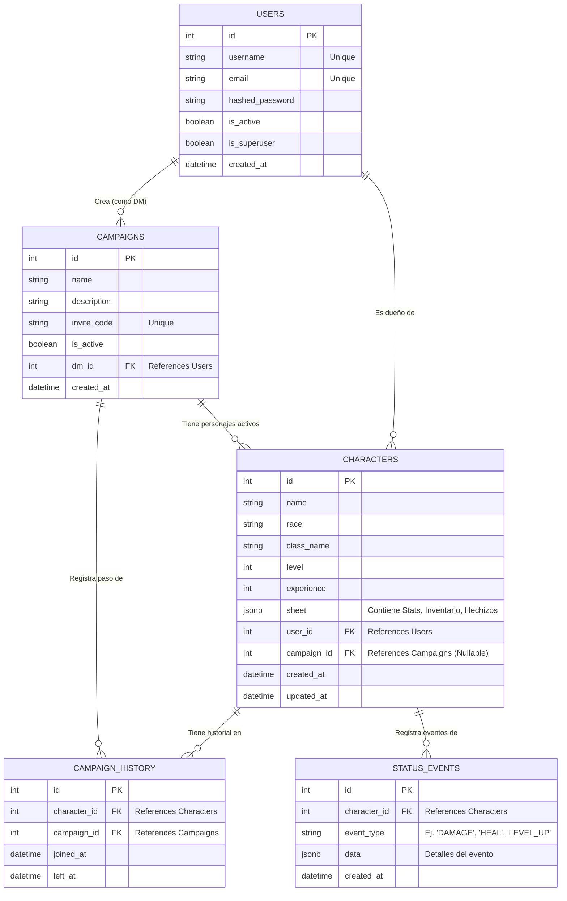

# Diagrama de Base de Datos (Entidad-Relación)

A continuación se detalla la estructura relacional de la base de datos alojada en PostgreSQL.

## Explicación de las Entidades Principales

1. **USERS (Usuarios):** La tabla base del sistema. Un usuario puede ser el dueño de múltiples personajes y, simultáneamente, ser el *Dungeon Master (DM)* creador de múltiples campañas.
2. **CAMPAIGNS (Campañas):** Representa una partida activa dirigida por un DM (un usuario). Tienen un `invite_code` para que otros jugadores puedan unir sus personajes a ella.
3. **CHARACTERS (Personajes):** Son creados por un usuario. Cada personaje pertenece estrictamente a **un (1) solo usuario**, pero de manera opcional (Nullable) puede estar en **una (1) sola campaña** de forma simultánea. El campo `sheet` almacena de forma dinámica en formato `JSONB` todas las estadísticas complejas (Fuerza, Destreza, Trasfondo, Equipo, Vida, etc.), brindando gran flexibilidad si las reglas de D&D varían o se añaden *homebrews*.
4. **CAMPAIGN_HISTORY (Historial de Campañas):** Permite rastrear la trayectoria de un personaje. Debido a que un personaje solo puede estar en una campaña activa, este historial sirve para registrar en cuáles campañas ha estado anteriormente una vez que las termina o las abandona.
5. **STATUS_EVENTS (Eventos de Estado):** Es una tabla pensada para el lado del DM y la auditoría. Permite registrar cuándo un personaje sufre un evento importante (sana vida, sufre daño letal, sube de nivel, cambia alineamiento). Se almacena con un tipo de evento y un JSON con el detalle.
